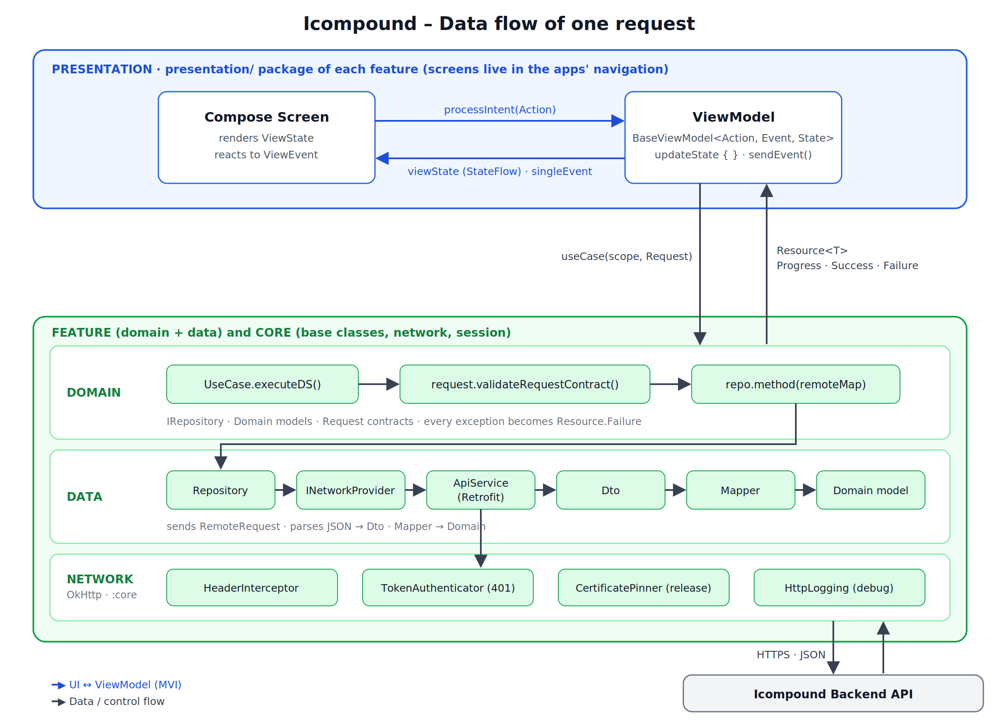

# Icompound

Icompound is a compound-management CRM for residents, compound management and maintenance staff, built as **two Android apps on one shared foundation**.

| App | Users | What it does |
|---|---|---|
| `app-admin` | Admins | Compounds, units, residents, staff, requests, billing |
| `app-resident` | Residents, compound management, maintenance staff | Maintenance tickets (slots, photos), visitor QR passes, facility booking with online payment, monthly bills and receipts, announcements and notifications, compound map. Screens are gated by role. |

Backend: **EyeCompound API** (OpenAPI spec v1.1). DTOs are written from the spec; the generated Postman collection documents each request's parameters.

## Tech stack

Kotlin · Jetpack Compose · MVI · Coroutines + Flow · Koin · Retrofit + OkHttp + Gson · KVault (tokens) · Preferences / DataStore (session data) · JUnit + MockWebServer + Konsist · Spotless + Detekt + Android Lint · lefthook · GitHub Actions (fastlane planned).

## Architecture at a glance



* **Feature-first packages.** Every business area is one feature (`com.icompound.<name>`) with four packages: `presentation`, `domain`, `data`, `di`.
* **One-way dependencies:** `presentation → domain ← data`. Features depend on `core`, never on each other.
* **Errors are handled in one place.** `BaseUseCase` catches everything and turns it into `Resource.Failure(AppException)`. ViewModels never use `try/catch`.
* **State is MVI:** one immutable `ViewState`, one-shot `ViewEvent`s, user input as `ViewAction`s.

## Documentation

| Read this | When |
|---|---|
| [docs/architecture.md](docs/architecture.md) | You are new: layers, rules, how a request flows, diagrams |
| [docs/project-structure.md](docs/project-structure.md) | Where does a file go, how is it named, which package |
| [docs/core-components.md](docs/core-components.md) | How each base class works and when to inherit from it |
| [docs/adding-a-feature.md](docs/adding-a-feature.md) | **Step-by-step recipe** for a new feature or a new use case |
| [docs/adding-a-module.md](docs/adding-a-module.md) | New Gradle module, new feature module, new app |
| [docs/contributing.md](docs/contributing.md) | **Before your first PR**: branches, commit standard, hooks, what a PR must contain |
| [docs/testing-and-quality.md](docs/testing-and-quality.md) | Unit tests, previews, screenshots, instrumented tests, Konsist, Detekt, lint, ProGuard / R8 rules |
| [docs/ci-cd.md](docs/ci-cd.md) | The pipeline, secrets, release process, branch protection, fastlane plan |
| [docs/security-and-release.md](docs/security-and-release.md) | Secrets, tokens, pinning, release checklist |

## Quick start

1. Android Studio (latest stable) and JDK 17.
2. Put the build properties in `~/.gradle/gradle.properties` (never in the repo): `API_KEY`, `SOCKET_PORT`, `GOOGLE_CLIENT_ID`, `IC_COMPOUND_DATASTORE_NAME`, `REMOTE_URL`, `DEBUG_REMOTE_URL`. CI passes the same names as `ORG_GRADLE_PROJECT_<NAME>`; see [docs/ci-cd.md](docs/ci-cd.md#3-secrets-and-build-properties).
3. Install the git hooks once per clone: `lefthook install` (see [docs/contributing.md](docs/contributing.md#1-one-time-setup)).
4. Build and run (adjust module names to your `settings.gradle.kts`):
   ```bash
   ./gradlew :app-admin:assembleDebug
   ./gradlew :app-resident:assembleDebug
   ```
5. The hooks run these for you; to run them by hand:
   ```bash
   ./gradlew spotlessCheck detekt :quality:konsist:test test lint
   ```

## Adding a feature in short

1. Read the endpoint in the OpenAPI spec / Postman collection.
2. Create `com.icompound.<feature>` with `data/`, `domain/`, `presentation/`, `di/`.
3. Write in this order: **Dto → Domain model → Mapper → Request → IRepository → Repository → UC → Koin module → Contract → ViewModel → Screen**.
4. Register the Koin module and the navigation entry in the app(s).
5. Finish with the Definition of Done below.

Full walkthrough with code: [docs/adding-a-feature.md](docs/adding-a-feature.md).

## Definition of done (every feature)

- [ ] Unit tests: mapper, request contract, use case, repository (MockWebServer), ViewModel
- [ ] **Instrumented test** when the feature is a flow across screens or features, or depends on Android behaviour (see [contributing.md](docs/contributing.md#instrumented-tests-when-is-it-time))
- [ ] **`@Preview`s for every state**, in light and dark, every supported language (including RTL) and large font scale
- [ ] **Screenshots in the PR** of every screen added or changed, all states, themes and languages
- [ ] ProGuard / R8 rules in the feature's `consumer-rules.pro`; a release (minified) build was run
- [ ] Spotless, Detekt, Konsist `ArchitectureTest` and lint are green (pre-push hook and CI)
- [ ] No secrets, no demo flags, no `Log` / `println` / `printStackTrace` left in the code
- [ ] User-facing text is in `strings.xml` for every language; errors go through the shared `AppException → message` mapper
- [ ] PR title and commits follow the [commit standard](docs/contributing.md#4-commit-standard)
- [ ] Docs updated if a base class, convention or pipeline step changed

## Conventions in one table

| Thing | Pattern | Example |
|---|---|---|
| Feature package | `com.icompound.<snake_case>` | `com.icompound.phone_auth` |
| DTO | `<Noun>Dto`, `<Noun>ResponseDto` | `ManagerContactResponseDto` |
| Domain model | `<Noun>` | `ManagerContact` |
| Request | `<Verb><Noun>Request` | `GetManagerContactRequest` |
| Repository | `I<Feature>Repository` / `<Feature>Repository` | `IPhoneAuthRepository` |
| Use case | `<Verb><Noun>UC` | `GetManagerContactUC` |
| Mapper | `<Noun>Mapper` | `ManagerContactMapper` |
| Contract | `<Screen>Action / Event / State` | `PhoneAuthAction` |
| ViewModel | `<Screen>ViewModel` | `PhoneAuthViewModel` |
| Koin module | `<feature>Module` | `phoneAuthModule` |

## Workflow in one picture


Commit standard: Conventional Commits (`feat(phone_auth): add GetManagerContactUC`). Hooks: Spotless on commit, Detekt + Konsist + unit tests + lint on push (`lefthook.yml`). CI repeats them and adds instrumented tests. Details: [contributing.md](docs/contributing.md), [ci-cd.md](docs/ci-cd.md).

## Changing a base class

Base classes in `core` affect every feature. Change them only in a dedicated PR that also updates `docs/core-components.md`, the Konsist rules that mention them, and any affected tests.
