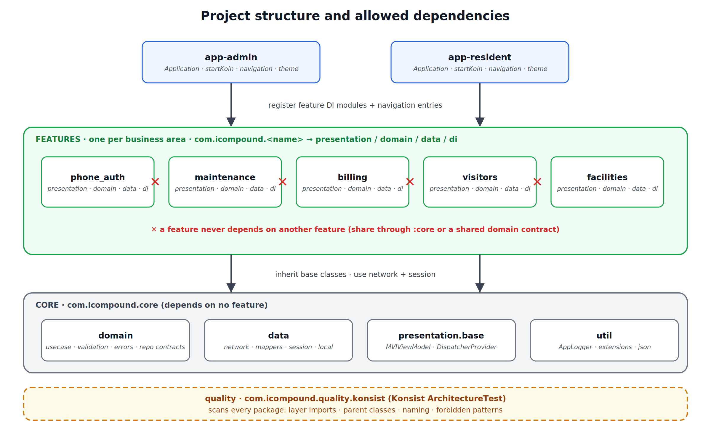
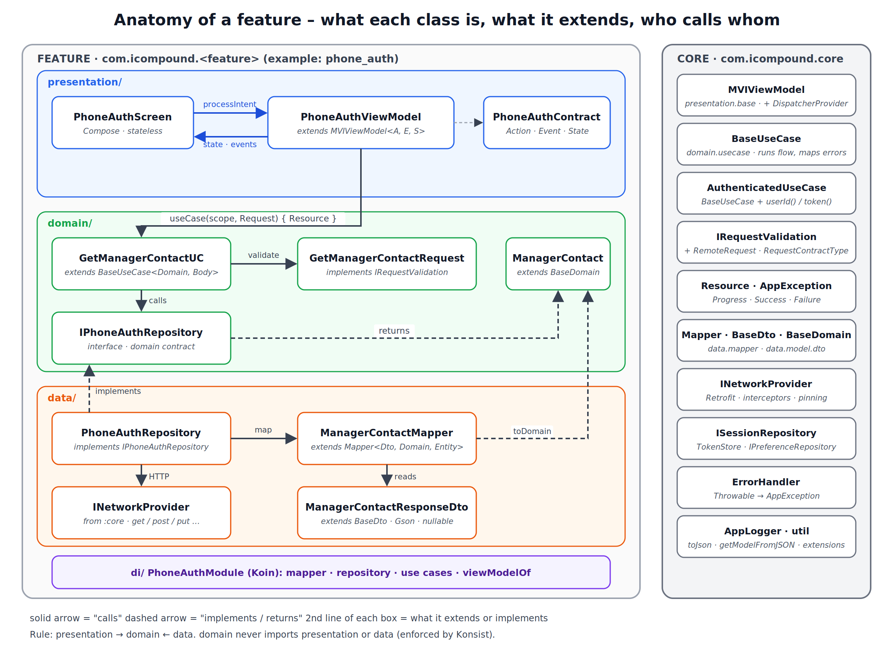
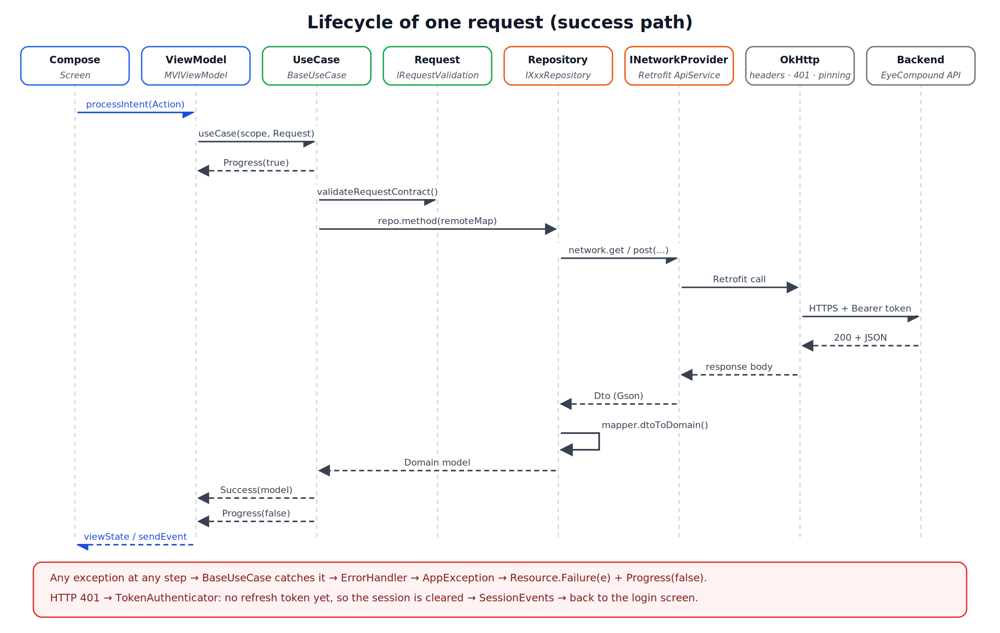
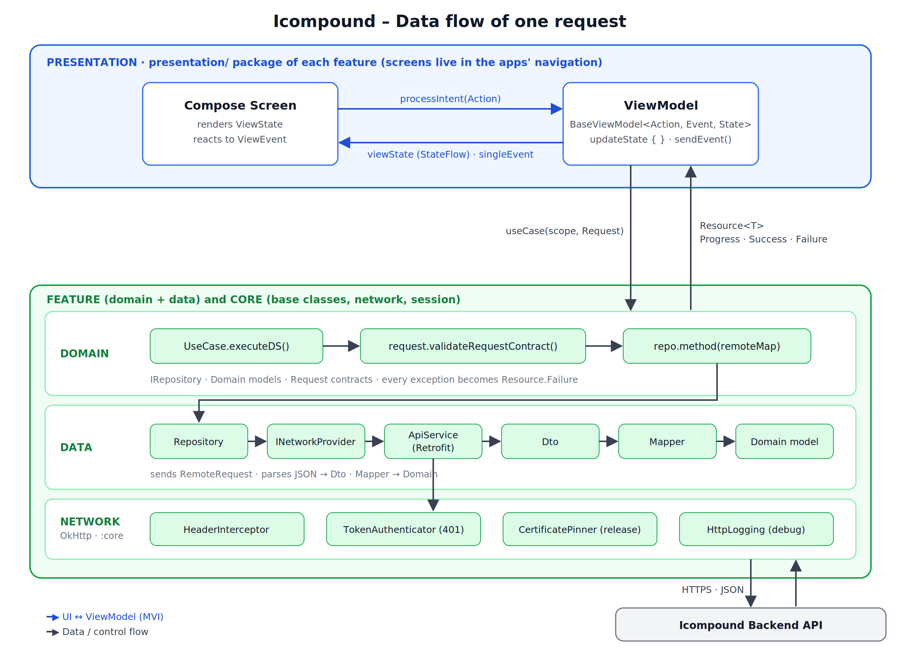

# Architecture

Icompound uses **Clean Architecture + MVI**, organised **by feature**. This page explains the layers, the rules and how one request travels through them.

## 1. The big picture



* **Apps** (`app-admin`, `app-resident`) are thin: `Application` (starts Koin), navigation, theme. They assemble features.
* **Features** are vertical slices: each owns its screens, use cases, repositories, DTOs and Koin module.
* **Core** holds everything shared: base classes, network, session, error handling, utilities.
* **Quality** (Konsist tests) scans all packages and fails the build when a rule is broken.

## 2. Inside a feature



| Layer | Package | Contains | May import |
|---|---|---|---|
| Presentation | `presentation/` | Contract (Action, Event, State), ViewModel, Compose screens | `domain`, `core` |
| Domain | `domain/` | Use cases, requests, domain models, repository **interfaces** | `core.domain` only |
| Data | `data/` | Repository **implementations**, DTOs, mappers | `domain`, `core` |
| DI | `di/` | One Koin module | everything in the feature |

**Dependency rule:** `presentation → domain ← data`. `domain` never imports `data` or `presentation`; `presentation` never imports `data`.

## 3. Life of one request



1. The screen calls `viewModel.processIntent(Action)`.
2. The ViewModel (`onActionTrigger`) calls a use case with a request.
3. `BaseUseCase` emits `Resource.Progress(true)`, then runs `executeDS` on the IO dispatcher.
4. `executeDS` calls `request.validateRequestContract()` (fails fast on missing or empty keys), then `repository.method(remoteMap)`.
5. The repository sends the call through `INetworkProvider`, which uses Retrofit/OkHttp. `HeaderInterceptor` adds the token. Certificate pinning protects the connection.
6. The JSON is parsed into a **Dto** (Gson), then the **Mapper** converts it into a **domain model**.
7. The use case emits `Resource.Success(model)` and `Resource.Progress(false)` on the main dispatcher.
8. The ViewModel calls `updateState { … }` and/or `sendEvent(…)`; the screen re-renders.

The same flow as a layer diagram:



## 4. What calls what (and who inherits from whom)

| Caller | Calls | Through | Returns |
|---|---|---|---|
| Screen | ViewModel | `processIntent(Action)` | nothing (state arrives via `viewState`) |
| ViewModel | Use case | `useCase(scope, body) { }` or `useCase(body).launchResult { }` | `Resource<Domain>` |
| Use case | Request | `validateRequestContract()` | throws `AppException.Local.RequestValidation` |
| Use case | Repository interface | `repo.method(remoteMap)` | domain model |
| Repository | `INetworkProvider` | `get / post / put / patch / delete …` | Dto |
| Repository | Mapper | `dtoToDomain(dto)` | domain model |
| Use case | `ISessionRepository` | `saveSession`, `requireUserId` | session data |
| `BaseUseCase` | `ErrorHandler` | `getError(throwable)` | `AppException` |

| Your class | Must extend / implement |
|---|---|
| ViewModel | `MVIViewModel<Action, Event, State>` |
| Action / Event / State | `ViewAction` / `ViewEvent` / `ViewState` |
| Use case | `BaseUseCase<Domain, Body>` or `AuthenticatedUseCase<Domain, Body>` |
| Request | `IRequestValidation` |
| Repository interface (domain) | nothing |
| Repository (data) | the interface `I<Feature>Repository` |
| Dto | `BaseDto` (responses) |
| Domain model | `BaseDomain` (when the API returns `message` / `code`) |
| Mapper | `Mapper<Dto, Domain, Entity>` (`Unit` if there is no database) |

## 5. Golden rules

1. **Exceptions never reach the ViewModel.** `BaseUseCase` catches them and delivers `Resource.Failure(AppException)`.
2. **The UI only knows domain models**, never DTOs or entities.
3. **State is one immutable data class** with defaults for every field. Navigation, snackbars and dialogs are **events**, not state.
4. **Constructor injection only.** No `KoinComponent`, no `by inject()` inside classes, no global singletons.
5. **No direct dispatchers.** Inject `DispatcherProvider`.
6. **ViewModels are never `single`** in Koin; use `viewModelOf`.
7. **One source of truth for the token**: `TokenStore`. Use cases never read or attach it.
8. **DTO fields are nullable with defaults**; the mapper provides real defaults.
9. **Features do not depend on each other.** Share through `core`.

## 6. Error handling

```
anything throws ─▶ BaseUseCase.runFlow().catch ─▶ ErrorHandler.getError() ─▶ AppException ─▶ Resource.Failure
```

| Cause | `AppException` |
|---|---|
| Missing or empty request key | `Local.RequestValidation` |
| No internet, timeout | `Local.IOOperation` |
| Certificate pinning failure | `Network.UntrustedConnection` |
| HTTP 401 | `Client.Unauthorized` (or `SessionExpired` after a failed refresh) |
| HTTP 422 | `Client.ResponseValidation(errors)` (field name to message) |
| Other 4xx / 5xx | `Client.Unhandled` / `Server.InternalServerError` |
| Anything else | `Unknown` |

The UI maps an `AppException` to a string resource in one shared function; it never shows `exception.message`.

## 7. State management (MVI)

* `ViewAction`: what the user asked for (`PhoneChanged`, `SendCodeClicked`).
* `ViewState`: everything needed to draw the screen. Updated only with `updateState { copy(...) }` (atomic).
* `ViewEvent`: one-shot effects (`Dial(phone)`, `NavigateToHome`). Delivered through a `Channel`, so each event is handled once.
* Long work is launched in a `Job` via `launchResult`, so back / resend / retry can cancel it.

## 8. Threading

| Work | Dispatcher |
|---|---|
| `executeDS` (repository, network, mapping) | `dispatchers.io` |
| Delivering `Resource` to the ViewModel | `dispatchers.main` |
| UI | Main |

Tests replace both with a `StandardTestDispatcher` (see [testing-and-quality.md](testing-and-quality.md)).
