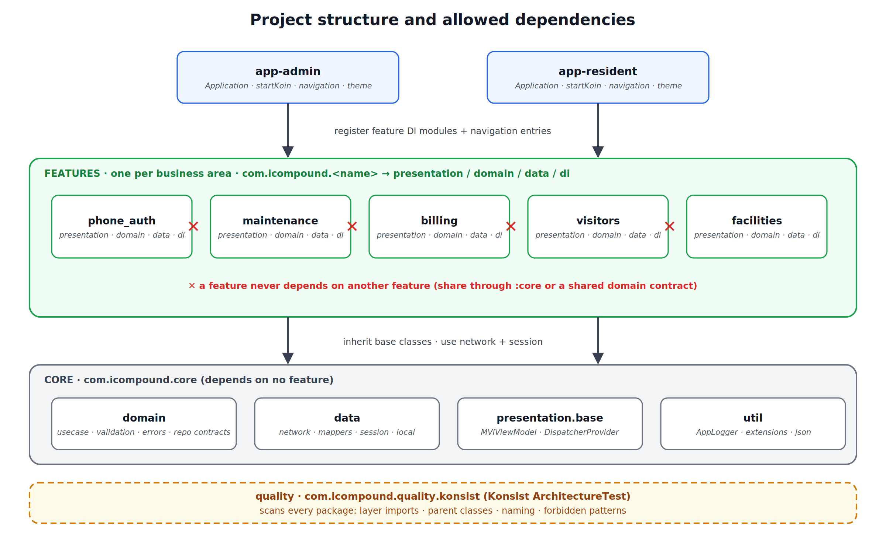

# Project structure and naming

> **Assumption to verify:** features are shown as Gradle modules (`:phone_auth`). If your features are packages inside one module, everything below still applies; ignore only the Gradle steps in [adding-a-module.md](adding-a-module.md). Where this page and your Konsist `ArchitectureTest` disagree, the test is the source of truth; fix whichever is wrong.

## 1. Repository layout

```
icompound/
├── core/                         # shared by every feature and app          com.icompound.core
├── phone_auth/                   # feature                                   com.icompound.phone_auth
├── maintenance/                  # feature                                   com.icompound.maintenance
├── billing/ visitors/ facilities/ …
├── app-admin/                    # Admin app                                 com.icompound.admin
├── app-resident/                 # Resident / management / staff app         com.icompound.resident
├── quality/konsist/              # Konsist ArchitectureTest  (:quality:konsist)  com.icompound.quality.konsist
├── docs/                         # this documentation
├── scripts/                      # check-commit-msg.sh (used by lefthook)
├── .github/                      # workflows/ (CI, PR title check), pull_request_template.md, dependabot.yml
├── lefthook.yml                  # local git hooks
├── version.properties            # VERSION_NAME / VERSION_CODE (checked on release tags)
├── fastlane/                     # planned
├── build.gradle.kts · settings.gradle.kts · gradle/libs.versions.toml
└── README.md
```

| Module | Depends on | Never depends on |
|---|---|---|
| `core` | third-party libraries only | any feature, any app |
| feature | `core` | other features, apps |
| app | `core`, features | other app |
| `quality:konsist` | scans all source sets (reads the code, no runtime dependency on the app) | not shipped |



## 2. `core` packages

`✔` = confirmed from the code that was shared; the rest follows the same convention, so verify it against the repo.

| Package | Contains |
|---|---|
| `core.domain.usecase` | `BaseUseCase` ✔, `AuthenticatedUseCase` |
| `core.domain.model` | `User` ✔, `BaseDomain` |
| `core.domain.model.error` | `ErrorHandler` ✔ |
| `core.domain.repo.local` | `IPreferenceRepository` ✔, `ISessionRepository` |
| `core.domain.repo.remote` | `INetworkProvider` |
| `core.domain.validation` | `IRequestValidation`, `RemoteRequest`, `RequestContractType` |
| `core.data.model` | `Resource` ✔ |
| `core.data.model.dto` | `BaseDto` |
| `core.data.model.exception` | `AppException` |
| `core.data.error` | `GeneralErrorHandlerImpl` |
| `core.data.mapper` | `Mapper` |
| `core.data.repo.local` | `SessionRepositoryImpl`, the preference data source |
| `core.data.repo.remote` | `ApiService`, `RetrofitNetworkProvider` |
| `core.network` | `auth/` (`TokenStore`, `TokenAuthenticator`, `SessionEvents`, `AuthRefreshApi`), `interceptor/` (`HeaderInterceptor`) |
| `core.presentation.base` | `MVIViewModel`, `ViewAction/ViewEvent/ViewState`, `DispatcherProvider` ✔ |
| `core.util` | `toJson` ✔, `getModelFromJSON`, extensions, `AppLogger` |
| `core.di` | `coreDiModule`, `networkModule`, `kVaultModule`, `sessionDIModule` |

Rule: `core.domain` must not import `core.data` or `core.presentation`.

## 3. Feature layout (copy this skeleton)

```
com.icompound.phone_auth/
├── data/
│   ├── dto/             ManagerContactDto.kt, ManagerContactResponseDto.kt
│   ├── mapper/          ManagerContactMapper.kt
│   └── repository/      PhoneAuthRepository.kt
├── domain/
│   ├── interactor/      GetManagerContactUC.kt
│   ├── model/           ManagerContact.kt
│   ├── model/request/   GetManagerContactRequest.kt
│   └── repository/      IPhoneAuthRepository.kt
├── presentation/
│   ├── PhoneAuthContract.kt      PhoneAuthAction · PhoneAuthEvent · PhoneAuthState
│   ├── PhoneAuthViewModel.kt
│   ├── PhoneAuthScreen.kt        Route (wires the ViewModel) + stateless Screen
│   └── components/               small composables used only by this feature
└── di/
    └── PhoneAuthModule.kt        public val phoneAuthModule
```

Per-module files: `build.gradle.kts`, `consumer-rules.pro`, `src/test/…` (unit tests), `src/androidTest/…` (integration tests, if any), `src/main/res/values/strings.xml` (prefix keys with the feature name, `phone_auth_…`).

### What goes in each folder

| Folder | File kind | Rules |
|---|---|---|
| `data/dto` | Gson response/request models | extend `BaseDto` (responses); every field nullable with a default; `@SerializedName`; no logic |
| `data/mapper` | `Mapper` subclasses | `internal`; only conversion; all null handling happens here |
| `data/repository` | repository implementation | `internal`; implements the domain interface; uses `INetworkProvider` and the mapper; **no try/catch, no validation** |
| `domain/model` | domain models | non-null fields; extend `BaseDomain` when the API returns `message`/`code`; computed helpers allowed (`hasPhone`) |
| `domain/model/request` | request holders | implement `IRequestValidation`; build `RemoteRequest`; declare every key in the contract |
| `domain/repository` | repository interfaces | one function per endpoint; returns a domain model; takes a `RemoteRequest` (or nothing) |
| `domain/interactor` | use cases | one business operation each; extend a base use case; validate, call repo, emit |
| `presentation` | contract, ViewModel, screens | ViewModel extends `MVIViewModel`; screens are stateless composables fed by state |
| `di` | Koin module | public; registers everything the feature owns |

## 4. Naming conventions

| Thing | Pattern | Example |
|---|---|---|
| Feature package | `com.icompound.<snake_case>` | `phone_auth` |
| DTO | `<Noun>Dto`, wrapper `<Noun>ResponseDto` | `ManagerContactResponseDto` |
| Domain model | `<Noun>` | `ManagerContact` |
| Request | `<Verb><Noun>Request` | `GetManagerContactRequest` |
| Repository interface | `I<Feature>Repository` | `IPhoneAuthRepository` |
| Repository | `<Feature>Repository` | `PhoneAuthRepository` |
| Use case | `<Verb><Noun>UC` | `GetManagerContactUC`, `VerifyOtpUC` |
| Mapper | `<Noun>Mapper` | `ManagerContactMapper` |
| Contract | `<Screen>Action`, `<Screen>Event`, `<Screen>State` | `PhoneAuthAction` |
| ViewModel | `<Screen>ViewModel` | `PhoneAuthViewModel` |
| Composables | `<Screen>Route`, `<Screen>Screen` | `PhoneAuthRoute` |
| Koin module | `<feature>Module` | `phoneAuthModule` |
| Tests | `<ClassUnderTest>Test` | `GetManagerContactUCTest` |
| Endpoint path constants | `private companion object` in the repository | `MANAGER_CONTACT_PATH` |

Verbs for use cases: `Get`, `Create`, `Update`, `Delete`, `Check`, `Send`, `Verify`, `Cancel`.

## 5. Visibility

* DTOs, mappers and repository implementations are `internal` to their module.
* Domain models, requests, repository interfaces, use cases and the Koin module are public (apps and other code need them).
* Contract types and ViewModels may be `internal`; the screen's `Route` is public so the app can put it in navigation.

## 6. Where shared things live

| Need | Put it |
|---|---|
| Used by one feature only | inside that feature |
| Used by two or more features | `core` (a base class, util, or shared domain model) |
| Shared UI components and theme | `designsystem` module, once it exists |
| Strings used by one feature | the feature's `strings.xml` |
| Build secrets | `local.properties` → `BuildConfig` (never in source) |
